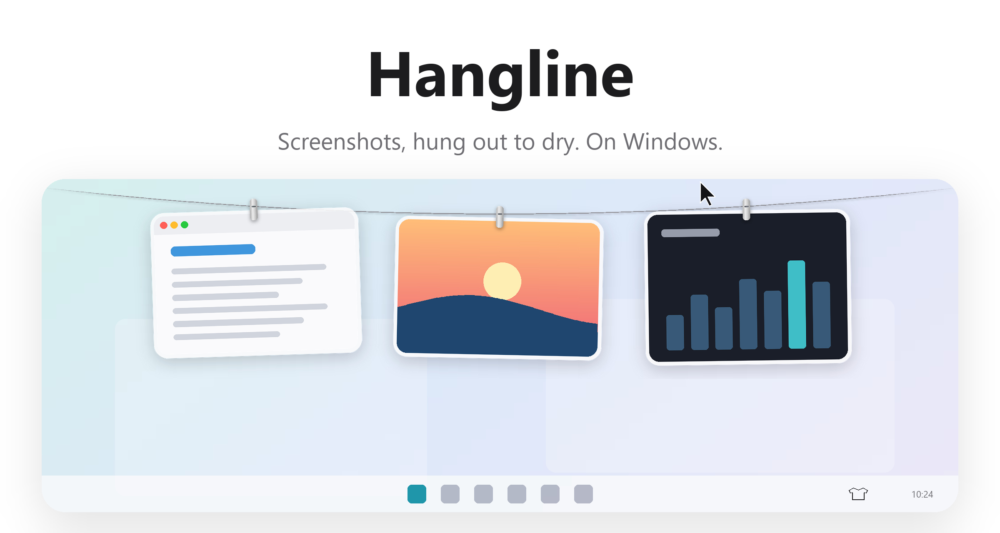
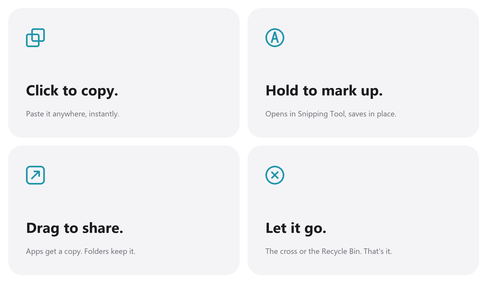

<picture>
  <source media="(prefers-color-scheme: dark)" srcset="docs/images/hero-dark.png">
  
</picture>

<p align="center">
  Free and open source. For Windows 10 and 11.
  <br>
  <a href="../../releases/latest">Download&nbsp;&rsaquo;</a>
  &nbsp;&nbsp;
  <a href="#build-from-source">Build from source&nbsp;&rsaquo;</a>
  <br><br>
  English&nbsp;·&nbsp;<a href="README.zh-CN.md">简体中文</a>
</p>

<p align="center">
  
  
  
  
  
</p>

<br>

## Out of sight. Within reach.

Every screenshot you take hangs on a line just above your screen.
Rest the pointer at the top edge and it glides down. Move away and it's gone.

<picture>
  <source media="(prefers-color-scheme: dark)" srcset="docs/images/demo-dark.gif">
  
</picture>

<br>
<br>

## A gesture for everything.

<picture>
  <source media="(prefers-color-scheme: dark)" srcset="docs/images/bento-dark.png">
  
</picture>

<br>
<br>

| | |
|:--|:--|
| Click | Copy the image. |
| Press and hold | Mark it up in Snipping Tool. The photo updates when you save. |
| Double click | Open it. |
| Middle click | Take a quick look. ← → go through the line. |
| Drag into an app | Send a copy. It stays on the line. |
| Drag into a folder | Keep it there. It leaves the line. |
| Drag to the Recycle Bin, or click the cross | Let it go. |
| Right click | Every action, plus taking down everything to one side. |
| Rest the pointer at the top edge | Bring the line down on that monitor. |
| Click at the top edge | Put it away. |
| <kbd>Ctrl</kbd>&thinsp;<kbd>Alt</kbd>&thinsp;<kbd>T</kbd> | Show or hide the line. Change it under Shortcut in the tray menu. |

<br>

## Your usual tool. Just less mess.

Hangline takes no screenshots of its own. Keep the shortcut you know, and
each capture hangs the instant you take it.

| If you capture with | Do this |
|:--|:--|
| **Snipaste**, copy to clipboard | Turn on *Hang copied images* in the tray menu. |
| **Win+Shift+S** | The same, or let Snipping Tool save captures automatically. |
| **Win+PrtScn** | Nothing. `Pictures\Screenshots` is watched already. |
| Anything that saves to a folder | Add that folder under *Also watch folders*. |

Turn on *Handle screenshots*<sup>1</sup> and new captures stay out of your
Screenshots folder. Only what you drag out is kept.

<br>

## Copied images too.

Copy an image from anywhere and it hangs on the line like any other. Turn on
*Hang copied images* in the tray menu and the shirt fills in while it is on.
Only images count. Anything copied along with text or a file, and anything a
password manager marks as private, is left alone.

<br>

## Private by design.

No account. No network. No analytics.
Hangline runs entirely on your PC, and your screenshots never leave it.

<br>

## Tech Specs

| | |
|:--|:--|
| **Compatibility** | Windows 10 and Windows 11, x64 |
| **Size** | 420 KB, with the .NET 8 Desktop Runtime |
| **Languages** | English, Chinese (Simplified) |
| **Built with** | C#, WPF and .NET 8 |
| **Network access** | None |
| **Price** | Free |

<br>

## Install

Install the [.NET 8 Desktop Runtime](https://dotnet.microsoft.com/download/dotnet/8.0) if you don't have it.
Then download `Hangline.exe` from the [latest release](../../releases/latest)
and run it. A T-shirt appears in the system tray: left click it to show the
line, right click it for settings.

To start Hangline with Windows, turn on *Open at login* in the tray menu.

<br>

## Build from source

```powershell
git clone https://github.com/violet227/hangline-win.git
cd hangline-win
dotnet run --project src/Hangline
```

Requires the .NET 8 SDK (`winget install Microsoft.DotNet.SDK.8`). To build a
single executable:

```powershell
dotnet publish src/Hangline -c Release -r win-x64 --self-contained false -p:PublishSingleFile=true -o publish
```

To try a build without touching your real settings, set `HANGLINE_DATA` to an
empty folder first.

<details>
<summary>Inside the app</summary>
<br>

| File | Role |
|:--|:--|
| `App.cs` | Tray icon, shortcut, and revealing and tucking away the line |
| `UI/LineWindow.cs` | The transparent, click-through strip along the top of the screen |
| `UI/Layout.cs` | Sizes, the rope's curve and where each photo hangs |
| `UI/PeggedCard.cs` | One photo: glass frame, clip, swing, breeze, and every gesture |
| `UI/Animation.cs` | Springs with SwiftUI's parameters, driven once per frame |
| `UI/Flight.cs` | A capture flying up to the line, and a photo falling off it |
| `Core/Line.cs` | What is hanging, and what you can do with it |
| `Core/ScreenshotWatcher.cs` | Notices new screenshots, and handles them when asked to |
| `Core/ClipboardWatcher.cs` | Notices images copied to the clipboard |
| `Core/Shell.cs` | Markup, open at login, full screen detection |

Every image here, the icon included, is drawn in code by
`tools/make_icon.py` and `tools/make_readme_art.py`.

</details>

<br>

---

<sub>
1. On first launch, Hangline offers to handle your screenshots. If you accept, each new capture moves from <code>Pictures\Screenshots</code> into Hangline's own folder, <code>%LOCALAPPDATA%\Hangline\Screenshots</code>. Drag one out to keep it; the cross sends the rest to the Recycle Bin. No system settings are changed, and you can turn it off from the tray menu. Hangline hides automatically while an app is in full screen.
</sub>

<br>
<br>

<p align="center">
  
  <br>
  <sub>A Windows port of <a href="https://github.com/alejandrobujan/tendedero">Tendedero</a> by Alejandro Buján. Its own name and icon, as Tendedero's license asks. See <a href="THIRD_PARTY_NOTICES.md">THIRD_PARTY_NOTICES.md</a>.</sub>
</p>
