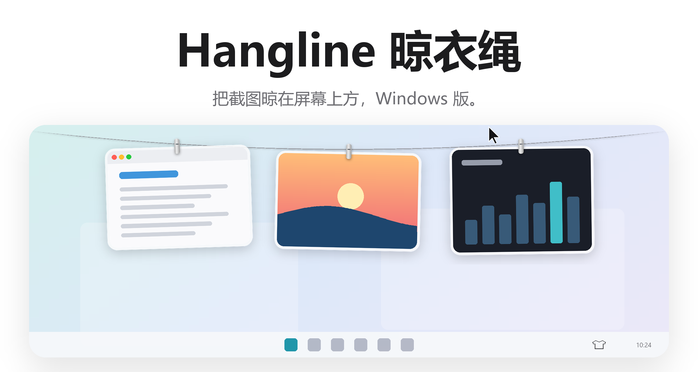
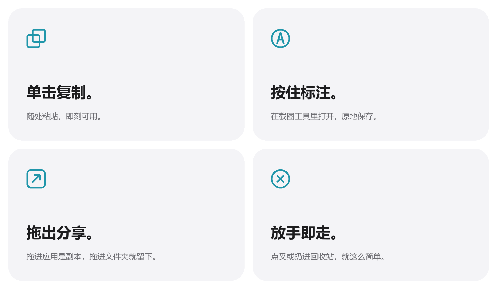
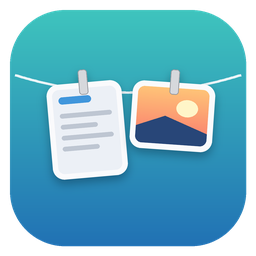

<picture>
  <source media="(prefers-color-scheme: dark)" srcset="docs/images/zh-CN/hero-dark.png">
  
</picture>

<p align="center">
  免费开源，适用于 Windows 10 和 11。
  <br>
  <a href="../../releases/latest">下载&nbsp;&rsaquo;</a>
  &nbsp;&nbsp;
  <a href="#从源码构建">从源码构建&nbsp;&rsaquo;</a>
  <br><br>
  <a href="README.md">English</a>&nbsp;·&nbsp;简体中文
</p>

<p align="center">
  
  
  
  
  
</p>

<br>

## 眼不见，手可及。

你截的每一张图，都挂在屏幕上方的一根绳子上。
指针停在屏幕顶边，绳子就轻轻放下来；移开，它就收回去。

<picture>
  <source media="(prefers-color-scheme: dark)" srcset="docs/images/zh-CN/demo-dark.gif">
  
</picture>

<br>
<br>

## 一个手势，一件事。

<picture>
  <source media="(prefers-color-scheme: dark)" srcset="docs/images/zh-CN/bento-dark.png">
  
</picture>

<br>
<br>

| | |
|:--|:--|
| 单击 | 复制图片。 |
| 按住 | 用截图工具标注，保存后绳上的图会自动更新。 |
| 双击 | 打开它。 |
| 鼠标中键 | 快速查看，← → 浏览绳上的其他图。 |
| 拖进某个应用 | 发送一份副本，图片仍留在绳上。 |
| 拖进文件夹 | 保存到那里，图片离开绳子。 |
| 拖到回收站，或点左上角的叉 | 丢弃它。 |
| 右键 | 所有操作，以及取下某一侧的全部图片。 |
| 指针停在屏幕顶边 | 在当前显示器上放下晾衣绳。 |
| 在屏幕顶边点击 | 收起晾衣绳。 |
| <kbd>Ctrl</kbd>&thinsp;<kbd>Alt</kbd>&thinsp;<kbd>T</kbd> | 显示或隐藏晾衣绳，可在托盘菜单的“快捷键”里修改。 |

<br>

## 用你习惯的工具，只是更清爽。

Hangline 本身不截图。继续用你熟悉的快捷键，截完的那一刻，图就挂上了。

| 你用什么截图 | 需要做什么 |
|:--|:--|
| **Snipaste**，复制到剪贴板 | 在托盘菜单里打开“挂上复制的图片”。 |
| **Win+Shift+S** | 同上；或者让截图工具自动保存截图。 |
| **Win+PrtScn** | 不用设置，`图片\屏幕截图` 默认就在监视。 |
| 任何会保存到文件夹的工具 | 在“同时监视文件夹”里添加那个文件夹。 |

打开“接管截图”<sup>1</sup>，新截图就不会堆在截图文件夹里，只有你拖出来的才会留下。

<br>

## 复制的图片也一样。

从任何地方复制一张图片，它都会像截图一样挂上绳子。在托盘菜单里打开“挂上复制的图片”后，托盘上的 T 恤图标会变成实心。
只有纯图片才会挂上。复制的内容如果同时带有文字或文件，或者被密码管理器标记为私密，都会被忽略。

<br>

## 隐私，从设计开始。

无需账号，不联网，不做任何统计。
Hangline 完全在你的电脑上运行，你的截图不会离开它。

<br>

## 技术规格

| | |
|:--|:--|
| **兼容性** | Windows 10 及 Windows 11，x64 |
| **大小** | 420 KB，需要 .NET 8 桌面运行时 |
| **语言** | 简体中文、英文 |
| **技术栈** | C#、WPF、.NET 8 |
| **网络访问** | 无 |
| **价格** | 免费 |

<br>

## 安装

如果还没装过，先安装 [.NET 8 桌面运行时](https://dotnet.microsoft.com/download/dotnet/8.0)。
然后从 [最新发布](../../releases/latest) 下载 `Hangline.exe` 并运行。系统托盘里会出现一个 T 恤图标：左键点它显示晾衣绳，右键打开设置。

想让 Hangline 随 Windows 启动，在托盘菜单里打开“登录时打开”。

<br>

## 从源码构建

```powershell
git clone https://github.com/violet227/hangline-win.git
cd hangline-win
dotnet run --project src/Hangline
```

需要 .NET 8 SDK（`winget install Microsoft.DotNet.SDK.8`）。打包成单个 exe：

```powershell
dotnet publish src/Hangline -c Release -r win-x64 --self-contained false -p:PublishSingleFile=true -o publish
```

想试用新版本又不影响正在用的设置，可以先把 `HANGLINE_DATA` 指向一个空文件夹。

<details>
<summary>代码结构</summary>
<br>

| 文件 | 作用 |
|:--|:--|
| `App.cs` | 托盘图标、快捷键，以及放下和收起晾衣绳 |
| `UI/LineWindow.cs` | 屏幕顶部那条透明、可点穿的窗口 |
| `UI/Layout.cs` | 尺寸、绳子的弧度、每张图挂在哪里 |
| `UI/PeggedCard.cs` | 一张图：玻璃相框、夹子、摆动、微风，以及所有手势 |
| `UI/Animation.cs` | 沿用 SwiftUI 参数的弹簧动画，逐帧驱动 |
| `UI/Flight.cs` | 截图飞上绳子，以及图片掉落 |
| `Core/Line.cs` | 绳上挂着什么，以及每张图能做什么 |
| `Core/ScreenshotWatcher.cs` | 发现新截图，以及接管截图 |
| `Core/ClipboardWatcher.cs` | 发现复制到剪贴板的图片 |
| `Core/Shell.cs` | 标注、登录时打开、全屏检测 |

这里的每一张图，包括图标，都是 `tools/make_icon.py` 和 `tools/make_readme_art.py` 用代码画出来的。

</details>

<br>

---

<sub>
1. 第一次启动时，Hangline 会问你是否接管截图。同意后，每张新截图都会从 <code>图片\屏幕截图</code> 移到 Hangline 自己的文件夹 <code>%LOCALAPPDATA%\Hangline\Screenshots</code>。想保留的拖出来即可，其余的点叉会进回收站。不会修改任何系统设置，随时可以在托盘菜单里关掉。有应用全屏时，Hangline 会自动隐藏。
</sub>

<br>
<br>

<p align="center">
  
  <br>
  <sub>Alejandro Buján 的 <a href="https://github.com/alejandrobujan/tendedero">Tendedero</a> 的 Windows 移植版。按照 Tendedero 许可证的要求，使用自己的名字和图标。详见 <a href="THIRD_PARTY_NOTICES.md">THIRD_PARTY_NOTICES.md</a>。</sub>
</p>
